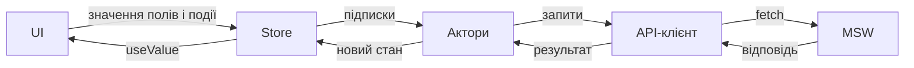

# Smart Sender — Webhooks

React-застосунок для роботи з вебхуками: вхід, пошук, пагінація та редагування.
API імітується через MSW; для запуску достатньо фронтенду.

## Запуск

```bash
npm install
npm run dev
```

Адресу застосунку показує Vite у терміналі. Для перегляду зібраної версії:

```bash
npm run build
npm run preview
```

Дані для входу: `demo@smartsender.com` / `SmartSender123!`.
На сторінці входу є підказка та кнопка заповнення форми.
Константи облікового запису спільні для UI та MSW і знаходяться в `src/demo.ts`.

## Стек

- React 19, TypeScript, Vite — компоненти, типізація та збірка.
- React Router 7 — маршрути, параметри списку та повернення з редактора.
- Власний external store на `useSyncExternalStore` — стан і події.
- Fetch — API-клієнт із CSRF та відновленням сесії.
- MSW 2 — імітація API у браузері та інтеграційних тестах.
- Tailwind CSS 4, `tailwind-merge` — оформлення компонентів і тема.
- Vitest, React Testing Library, jsdom — тести логіки та інтерфейсу.
- ESLint, Prettier — перевірки коду й форматування.

## Структура

```text
src/
├── main.tsx                   # Запуск MSW, React і BrowserRouter
├── App.tsx                    # Композиція маршрутів, сторінок та акторів
├── routing.ts                 # Читання page, search, id та returnTo
├── actors/                    # Сценарії та побічні ефекти
│   ├── LoginActor.tsx
│   ├── SessionActor.tsx
│   ├── WebhooksActor.tsx
│   └── EditWebhookActor.tsx
├── store/                     # Стан, події та групи appStore
│   ├── state.ts               # createState, createEvent, createListenerHook
│   ├── AppStore.ts
│   ├── session.ts
│   ├── login.ts
│   ├── webhooks.ts
│   ├── webhook.ts
│   ├── resource.ts
│   └── notifications.ts
├── api/                       # Типізовані запити та протокол API
│   ├── client.ts
│   ├── auth.ts
│   ├── webhooks.ts
│   ├── types.ts
│   ├── errors.ts
│   ├── http.ts
│   ├── fingerprint.ts
│   └── runtime.ts
├── ui/
│   ├── components/
│   │   ├── common/            # Button, TextField, Notice, Icon тощо
│   │   └── layout/            # Layout, Sidebar, Topbar
│   └── pages/
│       ├── LoginPage/
│       ├── WebhooksPage/
│       └── EditWebhookPage/
├── mocks/                     # MSW handlers, дані та браузерний worker
├── i18n/                      # Українські тексти інтерфейсу
└── styles/global.css          # Tailwind, тема, шрифти та базові стилі

tests/
├── api/                       # Протокол API та інтеграція з MSW
├── actors/                    # Сценарії акторів та взаємодія з UI
├── store/                     # Стан, події та React-підписки
└── routing.test.ts            # Адреса повернення з редактора

public/                        # MSW worker і логотип
```

Кожна сторінка має `index.ts` і папку `components` для власних компонентів.
Пошук, таблиця та пагінація знаходяться в `WebhooksPage/components`, форма
редагування — в `EditWebhookPage/components`. Спільні компоненти лежать у
`ui/components`.

## Архітектура

### Відповідальність шарів

| Шар    | Відповідальність                                                                |
| ------ | ------------------------------------------------------------------------------- |
| UI     | Відображення стану, введення значень і надсилання команд користувача.           |
| Store  | Зберігання значень, сповіщення підписників, події та прості операції скидання.  |
| Актори | Умови виконання сценарію, переходи станів, API-запити, скасування та навігація. |
| API    | HTTP-протокол, авторизація, повтори запитів і нормалізація помилок.             |
| MSW    | Відповіді API, перевірка даних та стан імітованого сервера.                     |

UI та актори працюють зі store. API працює незалежно від React і
`appStore`; бізнес-сценарій координує актор. `App.tsx` визначає, коли потрібні
сторінка та її актор.



### Стан і події

Для спрощення керування станом замість Redux написані дві короткі функції
у `src/store/state.ts`: `createState` та `createEvent`. Перша створює
реактивний стан: зміна значення сповіщає підписників і оновлює React-компоненти,
які його читають. Друга створює події для взаємодії компонентів та акторів.

Їхній API:

- `createState<T>`: `get`, `set`, `useValue` та `useOnChange`.
  `useValue` використовує `useSyncExternalStore`; `set` сповіщає підписників
  лише при зміні значення за `Object.is`.
- `createEvent<T>`: `emit` та `useOnEvent`. Подія викликає поточних підписників
  і не зберігає переданий payload.

Внутрішній `createListenerHook` керує підпискою через `useEffect`, а
`useEffectEvent` забезпечує актуальний обробник після рендера.
Підписка автоматично завершується при розмонтуванні компонента.

`appStore` створюється один раз у `store/index.ts`. Його групи розділені за
сценаріями:

| Група / стан        | Що зберігається                                                          |
| ------------------- | ------------------------------------------------------------------------ |
| `session.state`     | Користувач, причина завершення сесії та статус виходу.                   |
| `login.state`       | Email, пароль, статус і помилка входу.                                   |
| `webhooks`          | Результат списку, ввід пошуку та лічильник оновлення.                    |
| `webhook`           | Значення редагованого вебхука, статус збереження та лічильник оновлення. |
| `notificationState` | Повідомлення про успішне збереження, незалежне від редактора.            |

Команди `login.login()`, `webhook.save()` та `session.logout()` надсилають
події. `refresh()` збільшує лічильник у відповідній групі, а актор реагує на
нове значення завантаженням даних. `createAppStore()` дозволяє створювати
ізольовані екземпляри для тестів.

Форми читають свої значення через `useValue()` і записують зміни через
`state.set(...)`. Умови запиту та очищення помилок при зміні полів реалізовані
в акторах. Компонент, якому потрібен стан, підписується на нього безпосередньо:
наприклад, `LoginForm`, `SearchInput` та `SavedNotice`. `LoginPage` лише
компонує компоненти.

`Resource<T>` описує дані запиту: `key`, `data`, `pending`, `error`.
Ключ пов'язує результат із поточними параметрами списку або id вебхука.
Зберігається поточний результат, який повторно завантажується при відкритті
відповідної сторінки.

`SaveState` — discriminated union зі статусами `SaveStatus.Idle`,
`Pending`, `Success` та `Error`. Тип дозволяє читати `error` лише у стані
помилки. Enum зберігаються поруч із відповідними модулями та експортуються
через їхній публічний API.

### Актори та їхній життєвий цикл

Актор — React-компонент логіки, обгорнутий у `memo`, який повертає `null`.
Він читає стан через `useValue()`, підписується на події та зміни стану і
керує запитами через `useEffect`.

| Актор              | Де працює            | Основні дії                                              |
| ------------------ | -------------------- | -------------------------------------------------------- |
| `LoginActor`       | Екран входу          | Вхід, очищення помилок і полів, оновлення сесії.         |
| `SessionActor`     | Авторизований layout | Вихід і реакція на завершення API-сесії.                 |
| `WebhooksActor`    | Список               | Завантаження, оновлення, пошук і пагінація.              |
| `EditWebhookActor` | Редактор             | Завантаження вебхука, збереження й повернення до списку. |

Актори монтуються поруч зі своїми сторінками в `App.tsx`.
Закриття сторінки завершує підписки, скасовує запити й очищує її групу стану.
`clearSession()` скидає сесію, дані входу та повідомлення; дані списку й
редактора очищують відповідні актори.

`AbortController` скасовує запит при закритті сторінки або зміні параметрів.
Перед публікацією результату актор перевіряє актуальність користувача та
запитаного ресурсу. Це захищає від запізнілих відповідей. Контролери та
актуальні знімки форми знаходяться в `useRef`; підписка `useOnChange`
синхронно оновлює знімок перед обробкою наступної події.

### Приклад: збереження вебхука

1. `WebhookForm` записує введені значення у `webhook.state.data`.
2. Відправлення форми викликає `webhook.save()`.
3. `EditWebhookActor` перевіряє стан, бере знімок полів і встановлює
   `SaveStatus.Pending`.
4. `updateWebhook()` виконує PUT. При помилці актор записує її у
   `saveState`, а форма показує повідомлення та помилки полів.
5. При успіху актор записує `NotificationType.WebhookSaved` у
   `notificationState` і повертає до списку. Редактор очищується, список
   завантажується, а `SavedNotice` показує «Зміни збережено».

Повторний submit під час запиту не створює другого збереження.
При зміні назви або URL актор прибирає попередню помилку збереження.
Повідомлення про успіх очищується при зміні параметрів списку, відкритті
редактора або завершенні сесії.

## Навігація

`page` і `search` зберігаються в URL списку. Це підтримує прямі посилання,
перезавантаження та навігацію назад/вперед. `searchState` містить поточний
ввід; `WebhooksActor` застосовує його після 300 мс без змін і повертає
пагінацію на першу сторінку.

Єдина подія `changeParams` приймає часткові параметри: `{ page }` або
`{ page: 1, search }`. Актор формує новий URL. `routing.ts` читає та
перевіряє параметри, а `WEBHOOKS_PAGE_SIZE` задає розмір сторінки API.

Посилання на редактор формує `location.state.returnTo` з поточної адреси
списку. Сторінка читає його для скасування, актор — для переходу після
збереження. При прямому відкритті редактора адресою повернення є
`/webhooks`.

## API та MSW

`api/auth.ts` і `api/webhooks.ts` містять типізовані функції запитів.
`api/client.ts` централізує протокол:

- Додає `X-Requested-With: XMLHttpRequest` та `credentials: include`.
- Перед першим запитом отримує CSRF через GET `/csrf`; на POST і PUT
  передає токен у `X-CSRF-TOKEN`.
- Після `419` оновлює CSRF і повторює запит один раз.
- Після `401` захищеного запиту виконує `/auth/token/rotate`.
  Паралельні запити очікують один спільний проміс оновлення сесії.
  Версія сесії дозволяє повторити запізнілий `401` без зайвого rotate.
- Завершення сесії змінює її покоління, тому старі відповіді не можуть
  продовжити роботу захищеного запиту.
- Піднімає HTTP-помилки як `ApiFailure` з даними відповіді та помилками полів.

`api/errors.ts` нормалізує помилки через `toRequestError()`. Актори використовують
цю функцію, щоб записати у store `RequestError` з HTTP-статусом або
`RequestErrorStatus.NetworkError`.

Вхід проходить через `/auth/login → /auth/token/issue → /v1/me`.
Device token залишається локально всередині функції входу. Пароль
очищується після входу або закриття форми. У localStorage зберігається
тільки 32-символьний fingerprint пристрою.

Спільні handlers у `mocks/handlers.ts` використовуються браузерним
`setupWorker` і тестовим `setupServer`. Мок перевіряє заголовки, дані входу
та полів, моделює сесію на 30 секунд, фільтрує й розбиває список на сторінки
та застосовує PUT.

`main.tsx` очікує запуск worker перед рендером React. MSW працює також у
зібраній версії. Дані та сесія живуть у пам'яті: після перезавантаження
потрібен повторний вхід, а зміни вебхуків скидаються. Captcha передається
як тестовий маркер.

## UI та імпорти

Tailwind-класи знаходяться у відповідних компонентах.
`styles/global.css` містить тему: кольори, шрифти, розміри та адаптивні
межі. `tailwind-merge` дозволяє перевизначати базові класи спільних
компонентів. Місце для помилок зарезервоване, щоб валідація не зсувала
елементи форми. Тексти інтерфейсу зібрані в `i18n/uk.ts`, логотип —
у `public/smart-sender-logo.svg`.

Зовнішні імпорти використовують аліаси та явні експорти `index.ts`:

```ts
import { appStore, SaveStatus } from '@/store';
import { updateWebhook, type WebhookInput } from '@/api';
import { Button, Icon, IconName } from '@ui/components';
```

Всередині модуля використовуються відносні імпорти потрібного файла.
Компоненти сторінки імпортуються з її локальної папки `components`.
Типи позначаються через `import type` або `type` в іменованому імпорті.

## Перевірки

```bash
npm run check          # Prettier → ESLint → Vitest → TypeScript і Vite
npm test               # Усі тести
npm run test:watch     # Тести під час розробки
npm run format         # Форматування
```

`tests` повторює відповідні модулі `src`.
Тести API перевіряють CSRF, відновлення сесії, паралельні й запізнілі
відповіді та інтеграцію з MSW. Тести store перевіряють знімки, підписки,
події й очищення. Тести акторів монтують компоненти та UI, зокрема в
`StrictMode`, і перевіряють сценарії входу, пошуку, навігації,
збереження, помилки й скасування запитів.

Prettier використовує чотири пробіли та сортує Tailwind-класи.
ESLint перевіряє правила React-хуків і вимагає фігурні дужки для всіх
умов та циклів.
